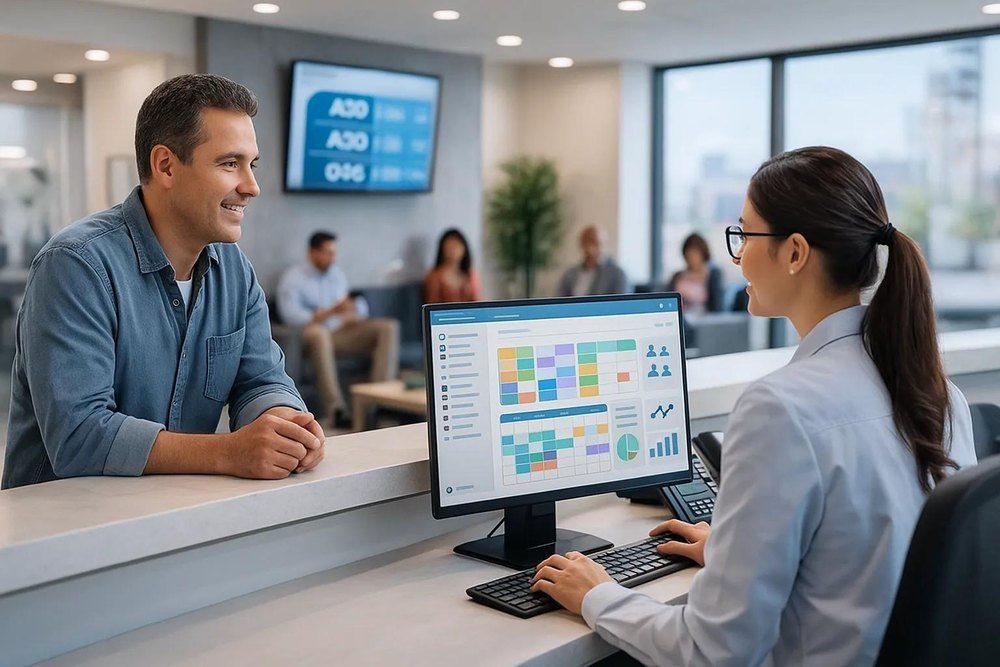
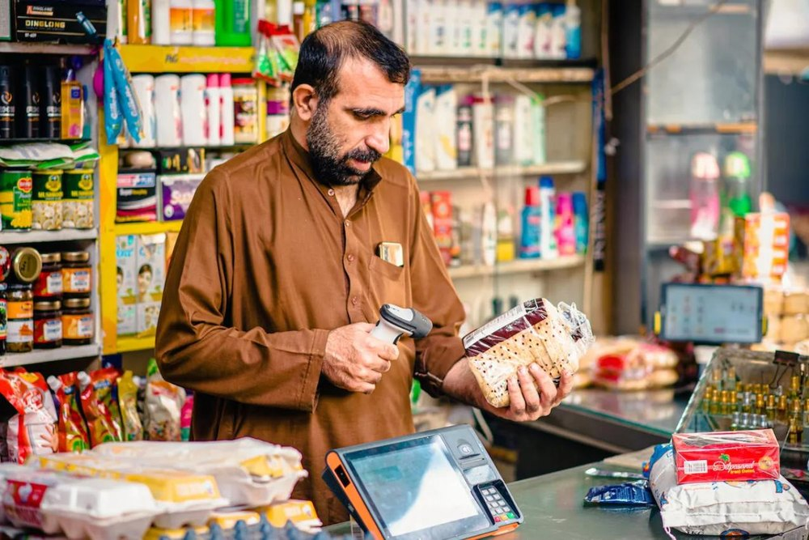
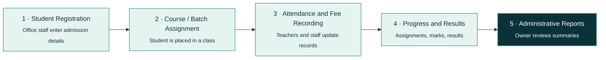
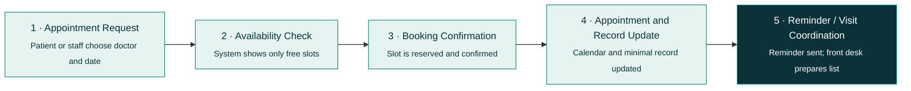
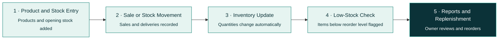
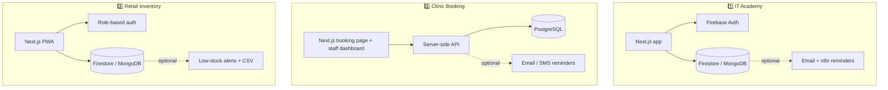
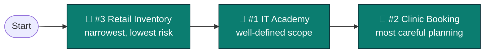
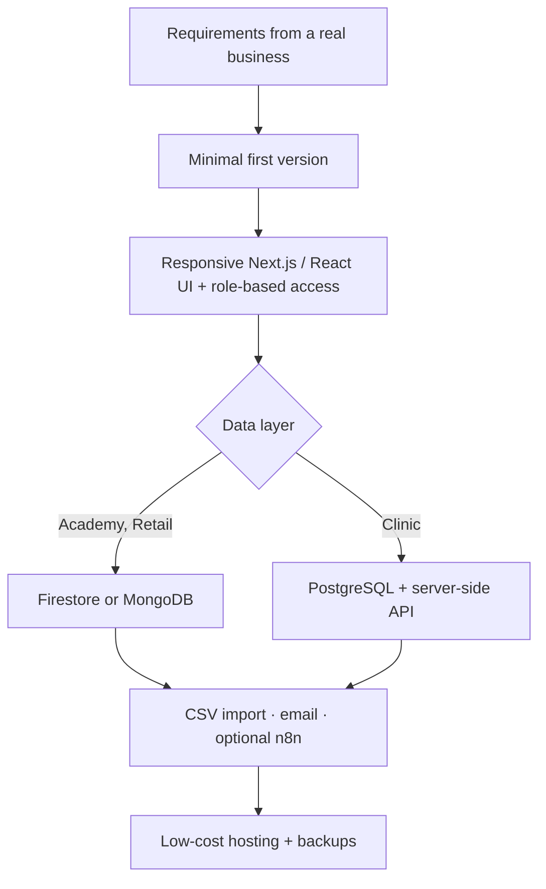
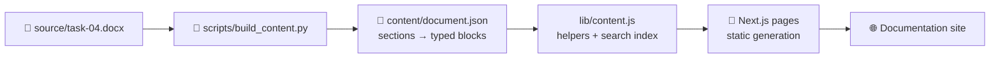

<div align="center">


<div align="center">


</div>

<br>


<a href="https://git.io/typing-svg"></a>

**Internship Task #04 · AI Automation Internship · Zayan Soft Tech**

*Research Identify Practical Project Real World Businesses*
*Innovating Digital Solutions | Empowering Digital Futures*

<br>

<p>
  
  
  
  
</p>
<p>
  
  
  
  
  
  
  
  
  
  
</p>

<br>

<h3>
  <a href="#-live-demo">🌐 Live Demo</a> ·
  <a href="#-the-three-project-ideas"> Ideas</a> ·
  <a href="#-proposed-workflows">🔄 Workflows</a> ·
  <a href="#-comparative-analysis"> Comparison</a> ·
  <a href="#-getting-started"> Run</a>
</h3>

</div>

<br>

---

> [!IMPORTANT]
> **This is a research and planning report.** None of the three proposed systems has been built, deployed or tested as part of this assignment. All features, workflows and technologies described here are **proposals** for future evaluation. This repository is the documentation web app of that report.

---

## 📑 Table of Contents

- [✨ Overview](#-overview)
- [👤 Author & Internship](#-author--internship)
- [🌐 Live Demo](#-live-demo)
- [💡 The Three Project Ideas](#-the-three-project-ideas)
  - [1️⃣ Smart IT Academy Management System](#1️⃣-smart-it-academys-management-system)
  - [2️⃣ Clinic Management & Appointment Booking System](#2️⃣-clinic-management--appointment-booking-system)
  - [3️⃣ Retail Shop Inventory & Stock Management System](#3️⃣-retail-shop-inventory--stock-management-system)
- [🔄 Proposed Workflows](#-proposed-workflows)
- [🧰 Proposed Technologies per Idea](#-proposed-technologies-per-idea)
- [🔬 Research on Existing Products](#-research-on-existing-products)
- [⚖️ Comparative Analysis](#-comparative-analysis)
- [🏆 Recommended Priority](#-recommended-priority)
- [🏗️ How the Three Systems Would Be Built](#️-how-the-three-systems-would-be-built)
- [🖥️ The Documentation Web App](#️-the-documentation-web-app)
- [🛠️ Tech Stack of This Web App](#️-tech-stack-of-this-web-app)
- [📂 Project Structure](#-project-structure)
- [🚀 Getting Started](#-getting-started)
- [📚 Research Sources](#-research-sources)
- [🔗 Previous Project & Connect](#-previous-project--connect)
- [⚠️ Honest Scope Notes](#️-honest-scope-notes)

---

## ✨ Overview

Many small and medium-sized businesses still run daily operations on **notebooks, spreadsheets, phone calls and chat messages**. That works at first, but it becomes slow, error-prone and hard to review as the business grows.

This report researches **three practical project ideas** for real-world businesses and presents each as a concept:

| # | 💡 Project Idea | 🏭 Primary Industry | 🎯 Core Purpose |
|:-:|---|---|---|
| **1** | Smart IT Academy Management System | IT academies and technical training institutes | Organise admissions, attendance, fees, assignments and results in one platform. |
| **2** | Clinic Management & Appointment Booking System | Clinics and small healthcare centres | Simplify appointment booking and the daily schedule (administrative use only). |
| **3** | Retail Shop Inventory & Stock Management System | Small and medium retail shops | Track stock, record sales and flag low-stock products. |

<div align="center">

<table>
<tr>
<td align="center"><br/><sub><b>#1 IT Academy</b></sub></td>
<td align="center"><br/><sub><b>#2 Clinic Booking</b></sub></td>
<td align="center"><br/><sub><b>#3 Retail Inventory</b></sub></td>
</tr>
</table>

<sub>Illustrative images from the source report. They show no real customers or patient data.</sub>

</div>

> [!NOTE]
> **Research method:** existing products were reviewed through their official web pages on **12 October 2026**. Statements about products are limited to what those pages said and carry numbered citations [1]–[7]. Text without a citation (features, workflows, technology choices, improvements) is the author's own recommendation. Prices and plan limits are as stated on those pages at the access date and may change.

---


## 🌐 Live Demo

> 🔗 **Live site:** *[https://research-identify-practical-project.vercel.app/](https://research-identify-practical-project.vercel.app/)*
>


---

## 💡 The Three Project Ideas

### 1️⃣ Smart IT Academy's Management System


**Industry:** IT academies, computer training institutes, coding academies, vocational training centres.

**Overview.** A responsive web platform that brings the daily operations of an IT academy into one place: admissions, course and batch enrolment, attendance, fee records, assignments, results, class schedules and announcements. Each user sees only the tools relevant to their role.

**Problem.** Small academies handle admissions in registers, attendance on paper or chat groups, and fees in spreadsheets. Records become scattered, fee balances are hard to confirm, attendance is hard to summarise and results reach students late.

<br clear="right"/>

#### 👥 Target Users

| Role | Main responsibilities in the system |
|---|---|
| **Academy Owner / Administrator** | Manages courses, batches, user accounts, fee records, reports and system settings. |
| **Teacher / Instructor** | Takes attendance, posts assignments, records assessment marks and follows student progress. |
| **Receptionist / Office Staff** | Registers students, maintains admission records, records fee payments, handles routine administration. |
| **Student** | Views courses, attendance, fee status, schedule, assignments, announcements and published results. |

> *Role-based permissions: a teacher cannot edit fee records, and a student sees only their own records.*

#### ⭐ Key Features

| | | |
|---|---|---|
| 📝 **Admission & enrolment** | 📚 **Course & batch management** | ✅ **Attendance tracking** |
| 💳 **Fee records** *(record keeping, not an online payment gateway)* | 🧪 **Assignments & assessments** | 🏅 **Results & progress** |
| 📢 **Announcements** | 📊 **Role-based dashboards & reports** | |

#### 📈 Business Benefits
- **Less repetitive paperwork:** details are entered once and reused.
- **One reliable record:** staff and owners share the same data.
- **Fewer fee-tracking mistakes:** dues and payments in a consistent format.
- **Better student experience:** students check schedules and status themselves.
- **Clearer decisions:** summaries show attendance, enrolment and pending fees.

#### 🔧 Suggested Improvements
Operations first · easy adoption (spreadsheet import, phone-friendly attendance) · low running cost · link to existing learning tools instead of rebuilding an LMS.

---

### 2️⃣ Clinic Management & Appointment Booking System


**Industry:** general medical clinics, dental clinics, specialist practices, small healthcare centres.

**Overview.** A web system that lets patients request or book appointments online and lets staff manage doctors' schedules, patient registration, cancellations and the daily list. It is **limited to administrative organisation** and provides no diagnosis or clinical decision support.

**Problem.** Small clinics book by phone, walk-in or messaging apps and note them in diaries or spreadsheets, causing double bookings, unclear availability, forgotten appointments and last-minute phone rescheduling.

<br clear="right"/>

#### 👥 Target Users

| Role | Main responsibilities in the system |
|---|---|
| **Clinic Owner / Manager** | Oversees operations, staff coordination, appointment activity and administrative reports. |
| **Receptionist / Front Desk** | Registers patients, schedules appointments, handles cancellations and rescheduling, coordinates the daily list. |
| **Doctor / Healthcare Provider** | Views their own schedule and only the patient information needed. |
| **Patient** | Requests or books appointments, views details, receives confirmations or reminders. |

> *Two separate interfaces: a simple mobile-friendly patient booking page with minimal details, and an authenticated staff dashboard with role-based access.*

#### ⭐ Key Features

| | | |
|---|---|---|
| 🧾 **Patient registration** (minimal) | 🗓️ **Doctor availability & scheduling** | 🌐 **Online booking with confirmation** |
| 🔔 **Reminders** (email by default, SMS optional) | 🔁 **Cancellation & rescheduling** | 📋 **Daily appointment dashboard** |
| 🗂️ **Basic visit records** (date, doctor, admin notes only) | 🔐 **Role-based access & reports** | |

#### 📈 Business Benefits
Fewer routine phone calls · clearer schedules · fewer forgotten appointments · better coordination.

> [!WARNING]
> **Privacy and healthcare safety note.** Collect only the data needed for booking and contact. Use secure authentication, role-based permissions, encrypted connections, backups and activity logs. Doctors see only the patient information they need. **No claim of regulatory compliance is made**; compliance with the health-data rules of the relevant country must be verified before real patient data is handled. Diagnosis and automated medical decisions are outside this proposal.

---

### 3️⃣ Retail Shop Inventory & Stock Management System


**Industry:** general stores, clothing shops, electronics retailers, convenience stores, other small and medium retailers.

**Overview.** A simple web-based system to keep product records, record stock coming in and going out, record sales, see low-stock products and review basic reports. It stays focused on practical inventory control rather than a full enterprise system.

**Problem.** Small shops track stock in notebooks or end-of-day spreadsheets. Counts drift from reality, items run out unnoticed, over-ordering ties up money and finding a product's quantity takes time.

<br clear="right"/>

#### 👥 Target Users

| Role | Main responsibilities in the system |
|---|---|
| **Shop Owner** | Oversees stock, sales records, product information and business reports. |
| **Store Manager** | Manages product records, stock levels, supplier information and replenishment. |
| **Cashier / Sales Staff** | Records sales so stock changes are reflected accurately. |
| **Inventory / Stock Staff** | Records incoming goods, performs stock counts, flags discrepancies or low stock. |

> *In a small shop one person may hold several roles, so one account can carry more than one role. Customers do not need accounts in the initial version.*

#### ⭐ Key Features

| | | |
|---|---|---|
| 📦 **Product & category management** | 🔄 **Stock-in and stock-out records** | 🧾 **Sales recording** (reduces stock automatically) |
| 🚨 **Low-stock alerts** | 🚚 **Supplier & purchase records** | 🔎 **Searchable inventory** |
| 📊 **Basic reports** | 🕵️ **User roles & activity tracking** | |

#### 📈 Business Benefits
More accurate stock records · fewer surprises · accountability through an activity log · better decisions.

**Future enhancements (not in the first version):** multi-branch management, advanced accounting, integration with existing POS or accounting tools.

---

## 🔄 Proposed Workflows

Each idea has a basic five-step workflow. These are **concept diagrams, not screenshots of working software.**

### 1️⃣ IT Academy



### 2️⃣ Clinic Booking



### 3️⃣ Retail Inventory



---

## 🧰 Proposed Technologies per Idea

> All technologies below are the **author's recommendations** for a possible future build. Their official documentation was not reviewed for this report and should be checked before implementation.

### 1️⃣ IT Academy

| Technology | Proposed use and reason | Status |
|---|---|:-:|
|  | One codebase for desktop and mobile with a dashboard per role. | 🟢 Essential |
|  | Secure sign-in and role-based permissions. | 🟢 Essential |
|  | Students, batches, attendance, fees, results. Managed backend means less server administration. | 🟢 Essential (choose one) |
|  | Load existing student lists, export reports. | 🟡 Optional |
|  | Announcements and fee reminders. | 🟡 Optional |
|  | Scheduled fee-due and absence reminders. | 🔵 Future option |

*Trade-off to evaluate: managed services such as Firebase reduce setup effort but create vendor dependence and usage-based costs.*

### 2️⃣ Clinic Booking

| Technology | Proposed use and reason | Status |
|---|---|:-:|
|  | Patient booking page and staff dashboard from one codebase. | 🟢 Essential |
|  | Doctor schedules with day and week views. | 🟢 Essential |
|  | Two patients choosing the same slot at once need consistent handling, which suits transactional storage (MongoDB as an alternative). | 🟢 Essential |
|  | Protects patient contact data and limits who can see what. | 🟢 Essential |
|  | Confirmations and reminders by email first. SMS may add message fees. | 🟡 Optional |

### 3️⃣ Retail Inventory

| Technology | Proposed use and reason | Status |
|---|---|:-:|
|  | Runs on a shop PC, tablet or phone without an app-store app. | 🟢 Essential |
|  | Products, stock movements and sales; low setup effort for small teams. | 🟢 Essential (choose one) |
|  | Separate permissions for owner, manager, cashier and stock staff. | 🟢 Essential |
|  | Load existing stock lists; helps non-technical owners start. | 🔷 Recommended |
|  | USB scanner or phone camera for faster lookup and counts. | 🟡 Optional |
|  | Alerts without opening the dashboard. | 🟡 Optional |

*Shop internet can be unreliable, so backups and offline-tolerant data entry should be evaluated early.*

### 🗺️ Proposed Architecture Sketches



*Illustrative sketches drawn from the proposed technologies above; none is implemented.*

---

## 🔬 Research on Existing Products

| # | Product | What its official page offers | Lesson for this proposal | For idea |
|:-:|---|---|---|:-:|
| [1] | **Moodle** | Free, open-source LMS for online courses; self-hosted or hosted; paid hosting, support and customisation via Moodle and certified partners. | Shows demand for adaptable, open education platforms. It is a course-delivery system and does not itself list admissions or fee tracking. | 1️⃣ |
| [2] | **Google Classroom** | Assignments with rubrics and grading, class management, sync with student information systems; some admin capabilities tied to paid Workspace for Education editions. | Strong for classwork and feedback; room for an operations-first tool for admissions, attendance and fees. | 1️⃣ |
| [3] | **Cliniko** | Practice-management software: scheduling, treatment records, invoices, payments. SMS charged per message; 30-day trial; pricing depends on practitioners. | The usual clinic bundle may be more than a small clinic needs, so scope is limited to appointments and minimal records. | 2️⃣ |
| [4] | **Cal.com** | Scheduling with availability rules, buffers, minimum notice, booking limits, calendar sync against double bookings, email and SMS reminders. | Shows good booking rules; front-desk workflow and patient registration are not described on the page. | 2️⃣ |
| [5] | **Odoo Inventory** | Real-time stock tracking, min-max replenishment, barcode scanning, multi-warehouse, valuation methods, reports; a free option with unlimited users. | A capability benchmark; its breadth may be a setup-complexity risk for non-technical staff *(author's inference)*. | 3️⃣ |
| [6] | **Square for Retail** | Real-time inventory, history of sales/restocks/adjustments, purchase orders, sales reports, barcode labels. Moving to Free removes smart inventory management, multi-location stock and barcode label printing. | Advanced functions can sit behind upgrades; core stock control should be available from the start. | 3️⃣ |
| [7] | **Zoho Inventory** | Barcode and RFID tracking, reorder-point low-stock alerts, multi-channel sync, reports. Free plan limited to 50 orders/month, 1 user, 1 location. | Low-stock alerts are standard; a one-user limit does not suit owner, cashier and stock roles. | 3️⃣ |

---

## ⚖️ Comparative Analysis

The comparison is **qualitative**. No cost, timeline or return-on-investment figures are given, because real effort depends on a real client's scope.

| Criterion | 1️⃣ IT Academy | 2️⃣ Clinic Booking | 3️⃣ Retail Inventory |
|---|---|---|---|
| **Primary business problem** | Scattered admission, attendance, fee and result records. | Manual appointment handling and double bookings. | Inaccurate stock records and unnoticed low stock. |
| **Main target users** | Owner, teachers, office staff, students. | Manager, receptionist, doctors, patients. | Owner, manager, cashier, stock staff. |
| **Core functions** | Enrolment, attendance, fees, assignments, results, reports. | Scheduling, online booking, reminders, daily dashboard. | Products, stock in/out, sales, low-stock alerts, reports. |
| **Implementation complexity** | Moderate | Moderate to high (privacy, slot consistency) | Low to moderate |
| **Initial technology approach** | Next.js with Firebase (auth and database). | Next.js with secure API, relational database and calendar. | Next.js installable web app with Firestore or MongoDB and CSV import. |
| **Expected business value** | Organised operations and transparent records. | Smoother booking and lighter front-desk workload. | Accurate stock and accountable sales and stock records. |
| **Adoption considerations** | Staff training; moving data from registers and sheets. | Patient trust, privacy rules, change to reception routine. | Low digital familiarity, unreliable internet, paper habits. |

### 📊 Rating Against Seven Criteria

The ratings are the **author's qualitative judgement**, not measured results.

| Criterion | 1️⃣ IT Academy | 2️⃣ Clinic Booking | 3️⃣ Retail Inventory |
|---|---|---|---|
| **Clarity of the business problem** | Clear | Clear | Very clear |
| **Number and type of users** | Staff and students | Staff and public patients | Staff only |
| **Practical usefulness** | High | High | High |
| **Feasibility of a minimum viable product** | Moderate | Moderate to lower | **Strongest** (narrow core) |
| **Affordability and ease of adoption** | Moderate | Moderate | **Strongest** |
| **Potential for future enhancement** | High | Moderate to high | Moderate to high |
| **Privacy and operational risk** | Lower to moderate | **Highest** (health-related personal data) | Lower |

### 📉 Visual Summary *(a visual reading aid of the table above, not measured data)*

<br>


```text
MVP feasibility          1 IT Academy  ██████░░░░  Moderate
                         2 Clinic      ████░░░░░░  Moderate to lower
                         3 Retail      ██████████  Strongest

Affordability / adoption 1 IT Academy  ██████░░░░  Moderate
                         2 Clinic      ██████░░░░  Moderate
                         3 Retail      ██████████  Strongest

Privacy / operational    1 IT Academy  ████░░░░░░  Lower to moderate
risk  (higher = riskier) 2 Clinic      ██████████  Highest
                         3 Retail      ██░░░░░░░░  Lower
```

<br>


---

## 🏆 Recommended Priority

> ### 🥇 Start with **Project #3 — Retail Shop Inventory & Stock Management System**
>
> It has the **narrowest and clearest first version** (products, stock movements, sales and low-stock alerts), serves staff users only, and handles mainly business data rather than sensitive personal data. That keeps privacy risk lower and makes it the easiest of the three to explain, build in stages and adopt. Its problem is also visible every day to a shop owner: stock that does not match reality.
>
> **🥈 Project #1** is a natural second step, since its operations-first scope is also well defined.
> **🥉 Project #2** needs the most careful planning because of patient privacy and the need for dependable slot booking.

<br>



<br>

This priority is a **starting recommendation**. It may change after requirements are gathered from actual businesses and the budget, skills and data-protection needs are known.

---

## 🏗️ How the Three Systems Would Be Built

If three different systems were built for these three businesses, the report suggests the following staged approach. This is a plan, not completed work.

| Stage | What happens | Applies to |
|:-:|---|---|
| **1** | Gather requirements from a real business: roles, current paper or spreadsheet process, budget, data-protection needs. | All |
| **2** | Keep the first version small: retail = products, stock movements, sales, low-stock alerts; academy = admissions, attendance, fees; clinic = appointments, reminders, registration. | All |
| **3** | Build a responsive Next.js (or React) front end with **role-based access** from day one. | All |
| **4** | Choose storage: Firestore or MongoDB for academy and retail; **PostgreSQL with a server-side API** for clinic slot consistency. | 1, 2, 3 |
| **5** | Add import and notifications: CSV import for existing lists; email first; SMS and n8n automation only if the business chooses. | 1, 3 (and 2 for reminders) |
| **6** | For the clinic, add privacy by design: minimal data, encrypted connections, backups, activity logs; verify local health-data rules before real data. | 2 |
| **7** | Evaluate free or low-cost hosting before recommending any paid service; evaluate backups and offline-tolerant entry for shops. | All |


<br>

---

## 🖥️ The Documentation Web App

This repository turns the Task #04 `.docx` into a **full documentation website**.

| Page | What it contains |
|---|---|
| 🏠 **Overview** | Hero with typing animation, three idea cards, example workflow, rating table, recommendation, author card |
| 📖 **Documentation** | All 7 sections of the report with sidebar, on-page table of contents, previous/next navigation |
| 💡 **Project Ideas** | The three concepts with images, users, features and privacy note |
| 🔄 **Workflows** | The three five-step diagrams |
| ⚖️ **Comparison** | Comparative analysis, seven-criteria rating, recommended priority |
| 📚 **Sources** | The seven reviewed product pages with access dates |

**Highlights:** ⌨️ search dialog (`/` or `Ctrl/Cmd + K`) · 🌗 dark/light theme · 📏 reading progress bar · 📱 tables become cards on mobile · 🔗 copy-link on headings · ♿ skip link, focus styles, reduced-motion support · 🔍 SEO metadata and Open Graph image.

---

## 🛠️ Tech Stack of This Web App

| Layer | Technology |
|---|---|
| Framework |  App Router, static generation |
| UI |  |
| Styling |  with CSS keyframe animations |
| Icons |  |
| Language |  |
| Content pipeline |  `source/task-04.docx` → `content/document.json` |
| Search | Client-side index served at `/search-index.json` |



---

## 📂 Project Structure

```text
zayan-task-04-project-ideas/
├── app/
│   ├── page.js                 # Overview
│   ├── docs/                   # Documentation (index + [slug])
│   ├── ideas/                  # Project ideas
│   ├── workflow/               # Three workflows
│   ├── compare/                # Comparison and priority
│   ├── sources/                # Research sources
│   └── search-index.json/      # Search index route
├── components/
│   ├── layout/Footer.jsx
│   ├── navigation/             # Navbar, Search, Sidebar, TOC, ReadingProgress
│   ├── research/               # Blocks, ResponsiveTable
│   ├── shared/                 # Breadcrumbs, PrevNext
│   └── ui/                     # ThemeToggle, CopyLink, Logo, TypingLine
├── content/document.json       # Generated content
├── data/site.js                # Site metadata, nav, links
├── lib/content.js
├── public/{logo,images}/
├── scripts/build_content.py
├── source/task-04.docx
├── styles/globals.css
└── tailwind.config.js
```

---

## 🚀 Getting Started

```bash
# 1. Clone (adjust to your repository name)
git clone https://github.com/YasirAwan4831/zayan-task-04-project-ideas.git
cd zayan-task-04-project-ideas

# 2. Install
npm install

# 3. Run in development
npm run dev          # http://localhost:3000

# 4. Production build
npm run build
npm start
```

**Rebuild the content from the source document**

```bash
pip install python-docx
npm run build:content    # needs pandoc for the loss check
```

**Environment variable**

| Variable | Purpose |
|---|---|
| `NEXT_PUBLIC_SITE_URL` | Deployed site URL, used for metadata and canonical links |

---

## 📚 Research Sources

All sources are **official product pages**, reviewed on **12 Oct 2026**. Product details can change, so they should be rechecked before use.

| No. | Source | Relevance | URL |
|:-:|---|---|---|
| [1] | Moodle | Open-source learning management system (Project #1) | https://moodle.org/ |
| [2] | Google Classroom for Education | Assignments, grading and class management (Project #1) | https://edu.google.com/workspace-for-education/products/classroom/ |
| [3] | Cliniko | Clinic practice-management and scheduling software (Project #2) | https://www.cliniko.com/ |
| [4] | Cal.com | Appointment scheduling with availability rules and reminders (Project #2) | https://cal.com/ |
| [5] | Odoo Inventory | Inventory and replenishment features (Project #3) | https://www.odoo.com/app/inventory |
| [6] | Square for Retail | Retail inventory and point-of-sale features (Project #3) | https://squareup.com/us/en/point-of-sale/retail |
| [7] | Zoho Inventory | Inventory control with reorder-point alerts (Project #3) | https://www.zoho.com/inventory/ |

<br>

---

## 🔗 Previous Project & Connect

| 📁 Previous project | Link |
|---|---|
| Assignment 01 — Dashboard | https://ai-automation-research.vercel.app/ |
| Assignment 02 — Dashboard | https://customer-inq-automation-workflow.vercel.app/ |
| Assignment 03 — Dashboard | https://ai-lead-qualification-requirement-auto.vercel.app/ |
| Assignment 04 — Dashboard | https://research-identify-practical-project.vercel.app/ |

<div align="center">

<a href="https://github.com/YasirAwan4831"></a>
<a href="https://linkedin.com/in/yasirawan4831"></a>
<a href="https://x.com/YasirAwan4831"></a>
<a href="https://yasirawaninfo.vercel.app/"></a>

</div>
<br>

---

## ⚠️ Honest Scope Notes

- ❗ **No system in this report is built, deployed or tested.** Features, workflows and technologies are proposals.
- ❗ Product statements come only from official pages reviewed on 12 October 2026; prices and plan limits may change.
- ❗ Ratings and comparisons are the author's **qualitative judgement**, not measurements. No cost, timeline or ROI figures are claimed.
- ❗ The clinic idea makes **no claim of regulatory compliance**; health-data rules of the relevant country must be verified before real patient data is handled.
- ❗ Images are illustrative and show no real customers or patients.
- ❗ Technology suggestions (React/Next.js, Firebase, MongoDB, PostgreSQL and similar) were not checked against their official documentation for this report.

<div align="center">

<br/>

## 👤 Author & Internship

<div align="center">


</div>

| | |
|---|---|
| 👨‍💻 **Prepared By** | Muhammad Yasir |
| 🎓 **Internship** | AI Automation Internship |
| 🏢 **Organization** | Zayan Soft Tech |
| 📌 **Task** | Internship Task #04 (Research & Planning) |
| 📅 **Submission Date** | 14 October 2026 |

---
<br><br>

**Made with 💚 by [Muhammad Yasir](https://yasirawaninfo.vercel.app/) · AI Automation Internship · Zayan Soft Tech**


</div>
