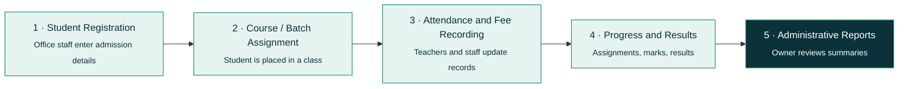

 

  <strong>Internship Task #04 · AI Automation Internship · Zayan Soft Tech</strong>
   
  <em>Research Identify Practical Project Real World Businesses — Innovating Digital Solutions | Empowering Digital Futures</em>

  
  
  
  
  

  
  
  
  
  
  
  
  
  
  

---

> [!IMPORTANT]
> **This is a research and planning report.** None of the three proposed systems has been built, deployed or tested as part of this assignment. All features, workflows and technologies described here are conceptual proposals.

---

## 📑 Table of Contents

- [✨ Overview](#-overview)
- [👤 Author & Internship](#-author--internship)
- [📚 Batch](#-batch)
- [🌐 Live Demo](#-live-demo)
- [💡 The Three Project Ideas](#-the-three-project-ideas)
  - [1️⃣ Smart IT Academy Management System](#1️⃣-smart-it-academys-management-system)
  - [2️⃣ Clinic Management & Appointment Booking System](#2️⃣-clinic-management--appointment-booking-system)
  - [3️⃣ Retail Shop Inventory & Stock Management System](#3️⃣-retail-shop-inventory--stock-management-system)
- [🔄 Proposed Workflows](#-proposed-workflows)
- [⚖️ Comparative Analysis](#-comparative-analysis)
- [🏗️ How the Three Systems Would Be Built](#️-how-the-three-systems-would-be-built)
- [🖥️ The Documentation Web App](#️-the-documentation-web-app)
- [🛠️ Tech Stack of This Web App](#️-tech-stack-of-this-web-app)
- [📂 Project Structure](#-project-structure)
- [🚀 Getting Started](#-getting-started)
- [📚 Research Sources](#-research-sources)
- [🔗 Previous Project & Connect](#-previous-project--connect)
- [⚠️ Honest Scope Notes](#️-honest-scope-notes)

---

## ✨ Overview

Many small and medium-sized businesses still run daily operations on **notebooks, spreadsheets, phone calls and chat messages**. That works at first, but it becomes slow, error-prone and hard to rely on as a business grows.

This report researches **three practical project ideas** for real-world businesses and presents each as a concept:

| # | 💡 Project Idea | 🏭 Primary Industry | 🎯 Core Purpose |
|:-:|---|---|---|
| **1** | Smart IT Academy Management System | IT academies and technical training institutes | Organise admissions, attendance, fees, assignments and results in one platform. |
| **2** | Clinic Management & Appointment Booking System | Clinics and small healthcare centres | Simplify appointment booking and the daily schedule (administrative use only). |
| **3** | Retail Shop Inventory & Stock Management System | Small and medium retail shops | Track stock, record sales and flag low-stock products. |

<table>
<tr>
<td align="center"> <b>#1 IT Academy</b></td>
<td align="center"> <b>#2 Clinic Booking</b></td>
<td align="center"> <b>#3 Retail Inventory</b></td>
</tr>
</table>

Illustrative images from the source report. They show no real customers or patient data.

> [!NOTE]
> **Research method:** existing products were reviewed through their official web pages on **12 October 2026**. Statements about products are limited to what those pages said and carry numbered citations.

---

## 🌐 Live Demo

> 🔗 **Live site:** *[https://research-identify-practical-project.vercel.app/](https://research-identify-practical-project.vercel.app/)*
>

---

## 💡 The Three Project Ideas

### 1️⃣ Smart IT Academy's Management System

**Industry:** IT academies, computer training institutes, coding academies, vocational training centres.

**Overview.** A responsive web platform that brings the daily operations of an IT academy into one place: admissions, course and batch enrolment, attendance, fee records, assignments, results, classroom management and reporting.

**Problem.** Small academies handle admissions in registers, attendance on paper or chat groups, and fees in spreadsheets. Records become scattered, fee balances are hard to confirm, attendance is difficult to track and reporting is time-consuming.

 

#### 👥 Target Users

| Role | Main responsibilities in the system |
|---|---|
| **Academy Owner / Administrator** | Manages courses, batches, user accounts, fee records, reports and system settings. |
| **Teacher / Instructor** | Takes attendance, posts assignments, records assessment marks and follows student progress. |
| **Receptionist / Office Staff** | Registers students, maintains admission records, records fee payments, handles routine administration. |
| **Student** | Views courses, attendance, fee status, schedule, assignments, announcements and published results. |

> *Role-based permissions: a teacher cannot edit fee records, and a student sees only their own records.*

#### ⭐ Key Features

| | | | |
|---|---|---|---|
| 📝 **Admission & enrolment** | 📚 **Course & batch management** | ✅ **Attendance tracking** | 🧾 **Batch reports & export** |
| 💳 **Fee records** *(record keeping, not an online payment gateway)* | 🧪 **Assignments & assessments** | 🏅 **Results & progress** | 📢 **Announcements** |

#### 📈 Business Benefits
- **Less repetitive paperwork:** details are entered once and reused.
- **One reliable record:** staff and owners share the same data.
- **Fewer fee-tracking mistakes:** dues and payments in a consistent format.
- **Better student experience:** students check schedules and status themselves.
- **Clearer decisions:** summaries show attendance, enrolment and pending fees.

#### 🔧 Suggested Improvements
Operations first · easy adoption (spreadsheet import, phone-friendly attendance) · low running cost · link to existing learning tools instead of rebuilding an LMS.

---

### 2️⃣ Clinic Management & Appointment Booking System

**Industry:** general medical clinics, dental clinics, specialist practices, small healthcare centres.

**Overview.** A web system that lets patients request or book appointments online and lets staff manage doctors' schedules, patient registration, cancellations and the daily list. It is **limited** to administrative scheduling and does not propose diagnostic tools.

**Problem.** Small clinics book by phone, walk-in or messaging apps and note them in diaries or spreadsheets, causing double bookings, unclear availability, forgotten appointments and last-minute disruptions.

 

#### 👥 Target Users

| Role | Main responsibilities in the system |
|---|---|
| **Clinic Owner / Manager** | Oversees operations, staff coordination, appointment activity and administrative reports. |
| **Receptionist / Front Desk** | Registers patients, schedules appointments, handles cancellations and rescheduling, coordinates the daily list. |
| **Doctor / Healthcare Provider** | Views their own schedule and only the patient information needed. |
| **Patient** | Requests or books appointments, views details, receives confirmations or reminders. |

> *Two separate interfaces: a simple mobile-friendly patient booking page with minimal details, and an authenticated staff dashboard with role-based access.*

#### ⭐ Key Features

| | | | |
|---|---|---|---|
| 🧾 **Patient registration** (minimal) | 🗓️ **Doctor availability & scheduling** | 🌐 **Online booking with confirmation** | 🔔 **Reminders (email by default)** |
| 🔁 **Cancellation & rescheduling** | 📋 **Daily appointment dashboard** | 🗂️ **Basic visit records** (date, doctor, admin notes only) | 🔐 **Role-based access & reports** |

#### 📈 Business Benefits
Fewer routine phone calls · clearer schedules · fewer forgotten appointments · better coordination.

> [!WARNING]
> **Privacy and healthcare safety note.** Collect only the data needed for booking and contact. Use secure authentication, role-based permissions, encrypted connections, backups and activity logs to protect patient privacy.

---

### 3️⃣ Retail Shop Inventory & Stock Management System

**Industry:** general stores, clothing shops, electronics retailers, convenience stores, other small and medium retailers.

**Overview.** A simple web-based system to keep product records, record stock coming in and going out, record sales, see low-stock products and review basic reports. It stays focused on practical features that small shops can use immediately.

**Problem.** Small shops track stock in notebooks or end-of-day spreadsheets. Counts drift from reality, items run out unnoticed, over-ordering ties up money and finding a product's quantity takes time.

 

#### 👥 Target Users

| Role | Main responsibilities in the system |
|---|---|
| **Shop Owner** | Oversees stock, sales records, product information and business reports. |
| **Store Manager** | Manages product records, stock levels, supplier information and replenishment. |
| **Cashier / Sales Staff** | Records sales so stock changes are reflected accurately. |
| **Inventory / Stock Staff** | Records incoming goods, performs stock counts, flags discrepancies or low stock. |

> *In a small shop one person may hold several roles, so one account can carry more than one role. Customers do not need accounts in the initial version.*

#### ⭐ Key Features

| | | | |
|---|---|---|---|
| 📦 **Product & category management** | 🔄 **Stock-in and stock-out records** | 🧾 **Sales recording** (reduces stock automatically) | 🚨 **Low-stock alerts** |
| 🚚 **Supplier & purchase records** | 🔎 **Searchable inventory** | 📊 **Basic reports** | 🕵️ **User roles & activity tracking** |

#### 📈 Business Benefits
More accurate stock records · fewer surprises · accountability through an activity log · better decisions.

**Future enhancements (not in the first version):** multi-branch management, advanced accounting, integration with existing POS or accounting tools.

---

## 🔄 Proposed Workflows

Each idea has a basic five-step workflow. These are **concept diagrams, not screenshots of working software.**

### 1️⃣ IT Academy

(remaining content unchanged...)

## 👤 Author & Internship

| | |
|---|---|
| 👨‍💻 **Prepared By** | Muhammad Yasir |
| 🎓 **Internship** | AI Automation Internship |
| 🏢 **Organization** | Zayan Soft Tech |
| 📌 **Task** | Internship Task #04 (Research & Planning) |
| 📅 **Submission Date** | 14 October 2026 |
| 🎯 **Batch** | AI Automation Internship · Batch 2026 |

---

**Made with 💚 by [Muhammad Yasir](https://yasirawaninfo.vercel.app/) · AI Automation Internship · Zayan Soft Tech**

